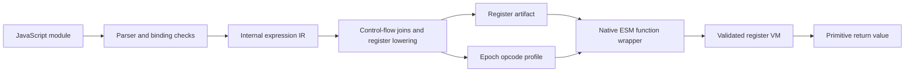

# JoVault register architecture

The executable foundation is `JOVLT-R0`. New compiler-input and signed-package
boundaries now include an optional signed Boa checkpoint path for broader language
experiments. R0 remains the default. The [compatibility contract](COMPATIBILITY.md) defines
their limits; the [validation record](VALIDATION.md) owns measured results and
integration status. The [roadmap](ROADMAP.md) defines remaining gates.



`frontend.ts` parses one virtual source file with the existing TypeScript parser.
It never resolves imports from disk. `FunctionCompiler` owns local bindings,
initialization state and instruction emission for one function. Unsupported syntax
produces a located error. Calls are limited to declared functions and imported
capabilities, preserving argument evaluation order.

`register-compiler.ts` analyzes the intermediate control-flow graph. Each reachable
instruction has a known temporary depth; joins must agree. Local slots and those
temporary positions become explicit registers. The runtime does not execute a
stack machine. The old IR interpreter is a test oracle under `tests/` and is absent
from the shipped runtime bundle.

## JavaScript, Rust, and WebAssembly

JavaScript is the language of the guest program. R0's compiler and interpreter are
written in TypeScript and execute as host JavaScript. Boa is a different JavaScript
engine, implemented in Rust. Compiling Boa to WebAssembly lets a browser or Node
instantiate that engine. Boa's JavaScript bytecode and WebAssembly's instructions
are separate instruction sets.

```text
Current R0 path
JavaScript source -> TypeScript compiler -> JoVault register artifact
                                              |
                               TypeScript register interpreter
                                              |
                                        primitive result

Optional Boa path
Rust engine source -> Rust compiler -> fixed WebAssembly engine image
                                              |
JavaScript source -> Boa compiler -> compiled register code and engine heap
                                              |
                          signed same-image memory checkpoint
                                              |
                   verify package -> restore -> Boa execution
```

The Boa path has a separate format and profile from R0. Its pinned engine is Boa 0.22; upstream
[CodeBlock source](https://github.com/boa-dev/boa/blob/337a3668a0dc86dd401ea20906e782249a64a228/core/engine/src/vm/code_block.rs)
shows its register-oriented execution model. The published API has no portable
compiled-module serializer. The probe instead retains a compiled script or linked
module, reaches a quiescent ABI boundary, and copies the Wasm memory for restoration
into the exact same engine image. A fresh instance receives no original source
argument at execution entry. The shared loader and Node compiler now connect that
mechanism to signed packages; they do not make the image a portable engine format.

The initial fresh-instance fixtures and later module-graph probes passed in Linux
CI; [validation](VALIDATION.md) records their separate source and image provenance.
The pinned binary audit found
one exported mutable stack global, no hidden mutable globals, passive segments,
table-mutation instructions, or start function, and a 64 MiB memory maximum. These
checks establish preconditions for that image's restoration path; they do not audit
arbitrary external state or every internal parser/compiler entry. Each changed image
needs the audit again. They also do not prove a source-free artifact.
The unmodified checkpoint retained the full original source as UTF-16LE
after its input buffers were cleared. Disabling source visibility in a host hook
does not by itself remove stored bytes. Source stripping needs separate engineering,
heap inspection, and semantic regression checks. A later source-retention patch
passed semantic regressions and checks for the absence of the exact full source
and comment markers; it does not establish removal of every source fragment.
Keep each checkpoint result bound to its engine image, build configuration, ABI,
and fixture hashes.

Wasm gives the embedded engine a bounded linear-memory interface. Its benefit depends
on the imports and capabilities granted by the host; it does not hide that memory
from the host owner. A whole-memory image can forge engine-internal state even when
the Wasm binary itself validates. Only an explicitly trusted, authenticated producer
may supply such images, and full state validation remains an open design problem.

## Boa checkpoint loading and execution

The shared [checkpoint module](../src/boa-checkpoint.ts) encodes `JOVLTBC1`: a bounded
binary header, metadata, and the exact linear-memory image. It uses the existing
`JOVLT-P1` kind `boa-checkpoint` with ABI 1. Operators pin both the Wasm image digest
and that image's binary-audit digest. `prepareBoaRuntime` checks both byte hashes,
the audit contract, module imports/exports and layout before returning an opaque
trusted runtime. A caller cannot replace that runtime with a structurally similar
plain object.

`instantiateBoaPackage` verifies the package signature, payload and expected context
before decoding or restoring heap bytes. It checks the image's memory/table/root
metadata and source-retention/fuel state, then restores a fresh matching instance.
These checks require a trusted producer. A valid signature does not prove that an
arbitrary Rust heap image has valid internal pointers or safe object state.

The instance exposes export names and one `main` invocation with bounded finite JSON
primitive arguments. Results remain primitives, including explicit representations
for undefined and special numeric results. No transparent object/function bridge is
provided. The 200,000-instruction context allowance is shared by evaluation, jobs,
and invocation. Linear memory is capped at 64 MiB. Expensive intrinsic work may have
a different cost from one dispatch; the count is not a wall-clock or total-memory
guarantee.

Boa package expiry is checked around restoration and before/after execution.
There is no per-instruction wall-clock callback in Boa. An already running operation
may reach expiry before it returns, at which point its result is rejected. The
external browser worker deadline is a separate cancellation mechanism. This differs
from R0's instruction-boundary clock checks. Both depend on an intact host and clock.

The profile grants no ambient filesystem, network, DOM or Node APIs. The engine has
its own standard intrinsics; the host supplies bounded entropy, while the clock is
fixed at Unix epoch zero and timezone UTC. Time-dependent semantics therefore form
an explicit restricted profile rather than ordinary host-clock equivalence.

The [Node compiler](../src/boa-compiler-node.ts) snapshots supplied modules and sends
them to a disposable worker. It compiles/links without evaluating guest top-level
statements, clears owned source/input buffers, verifies the expected root, export,
fuel and wipe state, and returns the checkpoint for signing in the parent process.
Caller source strings, editor content and program literals are outside that wipe.
Its deadline is five seconds; V8's old-generation limit is 128 MiB and the Wasm
linear-memory cap is separate. The demo admits only one Boa compilation at a time.
The compiler accepts an explicit bounded graph, while the demo submits one module
exporting `main`. There is no native or R0 fallback.

## R0 execution format

`JOVLT-R0` is a JSON-serialized instruction format with constant, import, function
and export tables. It is not yet a packed binary codec. Each function declares its
parameter and register counts. Every instruction has five integer fields:
`[opcode, dst, a, b, c]`. The [contract](../src/register-contract.ts) defines unused
zero fields and the operand rules for each operation.

| Family     | Operations                                                                    |
| ---------- | ----------------------------------------------------------------------------- |
| Values     | `constant`, `undefined`, `move`, `nop`                                        |
| Arithmetic | `add`, `subtract`, `multiply`, `divide`, `remainder`, `power`                 |
| Unary      | `negate`, `positive`, `not`, `bit_not`                                        |
| Bitwise    | `bit_and`, `bit_or`, `bit_xor`, `shift_left`, `shift_right`, `shift_unsigned` |
| Comparison | `equal`, `not_equal`, `less`, `less_equal`, `greater`, `greater_equal`        |
| Branches   | `jump`, `jump_false`, `jump_true`                                             |
| Calls      | `call`, `host_call`, `return`                                                 |

Call instructions identify a target, a contiguous argument-register window and a
destination. A new frame copies arguments into parameter registers; return writes
the caller's destination. Frames share the invocation's instruction allowance and
call-depth cap. All bytecode references and unused fields are validated before
execution. The VM snapshots accepted tables so later caller mutations cannot alter
a running instance. It accepts primitive values, with no guest property-access or
dynamic-source instruction.

The dialect maps these 32 meanings to numeric bytes using a separate
`jovault-register-dialect-0` derivation domain and a ten-minute epoch. Its identity,
epoch and validity interval must match the artifact. The supplied runtime checks
expiry before loading, invoking and executing instructions, and after host calls.
It does not trust that a recipient will keep this code or clock intact.

## Compiler-input graph

The [module reader](../src/module-graph.ts) discovers a bounded graph and retains
exact source text and dependency locations. Its Node adapter restricts file reading
to a stable project root, rejects symlink/junction and path aliases, and records
source hashes. The graph uses deterministic discovery order. That order is not ESM
evaluation order.

The graph is compiler input, not linked bytecode. Discovering an import, re-export,
JSON module, or literal dynamic import does not implement its runtime semantics.
The separate Boa adapter exercises selected graph semantics through restored
checkpoints and now has a signed local execution path. This does not provide
transparent native ESM objects, a general host bridge, or complete linker acceptance.
Bare host modules need exact capability grants; the reader does not
perform ambient npm or network resolution.
Filesystem checks reduce path ambiguity but cannot eliminate races in a changing
project tree. The adapter is not an operating-system filesystem sandbox.

## Authenticated package boundary

The `JOVLT-P1` package foundation signs a canonical manifest with Ed25519 and binds
payload bytes with SHA-256. The manifest identifies kind, application, deployment,
epoch and validity window, runtime digest, payload digest/length, and ABI. Callers
supply trusted public keys and expected context; the envelope cannot declare itself
trusted. Server signing code keeps private keys outside browser output.

The [verifier](../src/package.ts) validates and snapshots its inputs before async
cryptography, checks key/package validity before and after verification, and returns
an opaque verified result. The [register package loader](../src/package-loader.ts)
consumes verified bytes, decodes the artifact/profile, checks their epoch metadata
against the signed manifest, and then invokes R0's independent bytecode validator.
Matching an envelope's runtime hash is meaningful only if the loader also identifies
the actual runtime bytes it executes.

This foundation authenticates bytes relative to intact code and caller trust. It
does not establish confidentiality, one-time use, remote authorization, or hard
revocation on a modified client. Replay within an accepted window requires separate
server policy if it must be prevented. Verification also cannot turn malformed
engine-memory images into a supported serialization format. The R0 CLI's ordinary
hash manifest remains a distinct unsigned output path.

## Relationship to JoVM and the demo

JoVault's register format, number semantics, host boundary and dialect identity are
separate from JoVM's typed challenge VM, SDK protocol, key material and risk engine.
The compiler reuses the existing build-side deterministic random generator, with a
JoVault domain label. No JoVM secret or live deployment profile is an input. Generic
analysis methods can transfer across interpreters; architectural separation does
not prove resistance to an analyst who reads both projects.

The local demo serves fixed assets and a bounded compile endpoint. Native comparison
and VM execution happen in separate disposable browser workers. The server compiles
source without guest evaluation. R0's worker CSP blocks fetch and nested workers;
the optional Boa worker permits same-origin runtime/audit fetch and Wasm compilation,
with nested workers still blocked. Native source is code the
local user chooses to run; workers cannot provide a hard memory quota or undo its
effects. Signed demo loading uses the package boundary. Package/loader Node tests
and Chromium desktop/mobile checks exercised normal execution and rejection of
payload/signature tampering and wrong deployment context. They also covered recovery,
execution limits, reduced motion, and focus; exact outcomes belong in validation.
A bounded async/private-class example also ran through HTTP compilation, signing,
browser verification/restoration, and Boa execution, matching the awaited native
result. This is a local integration case, not whole-language conformance.
A local server that provides the page and trust key is a local trust setup, not a separately deployed
authority. The blog retains its independent no-JavaScript policy.
